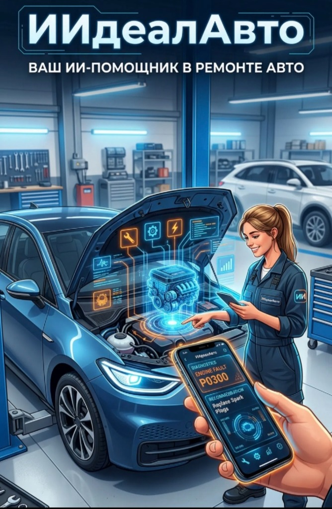
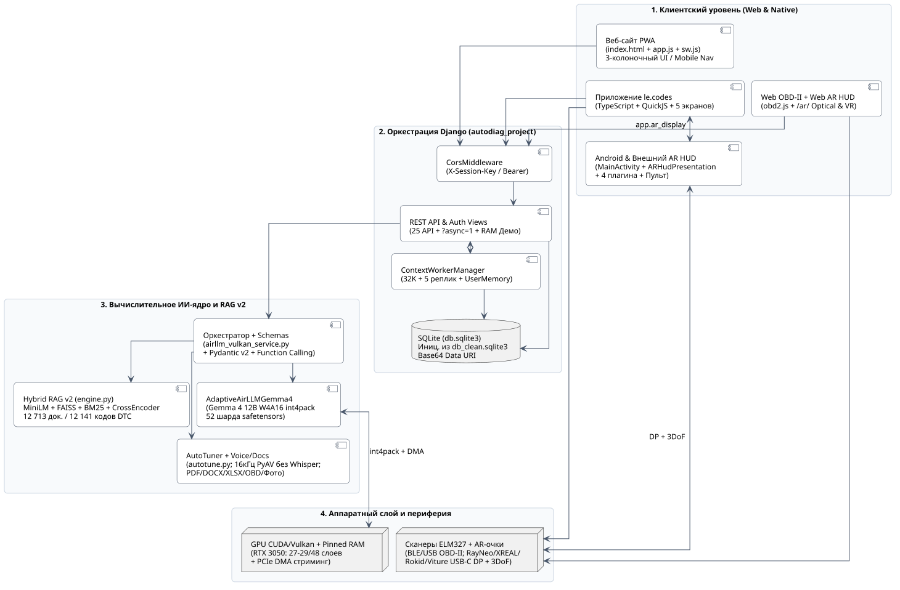
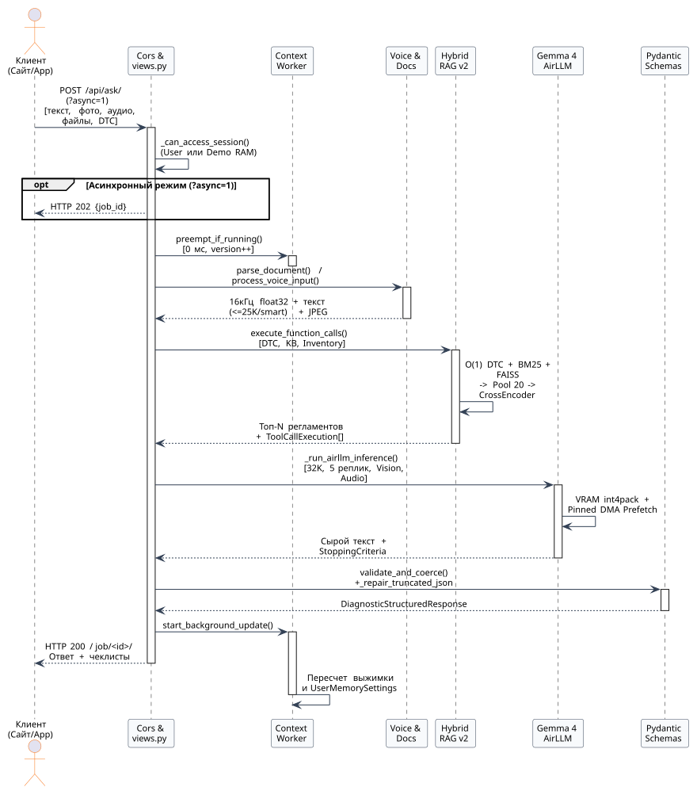
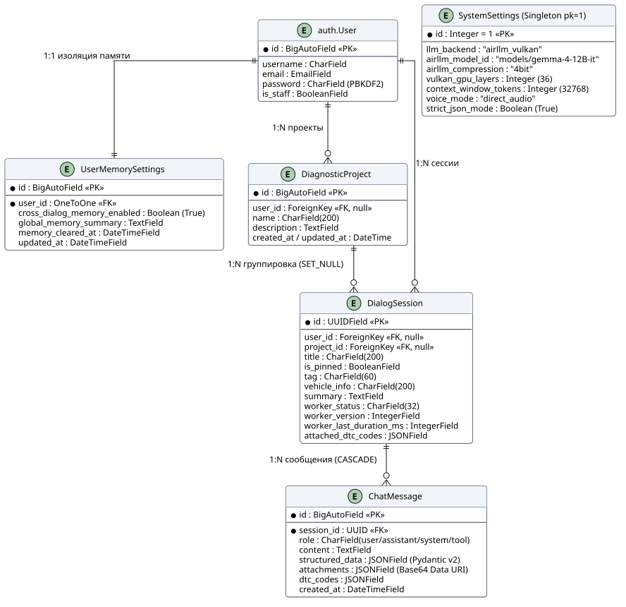
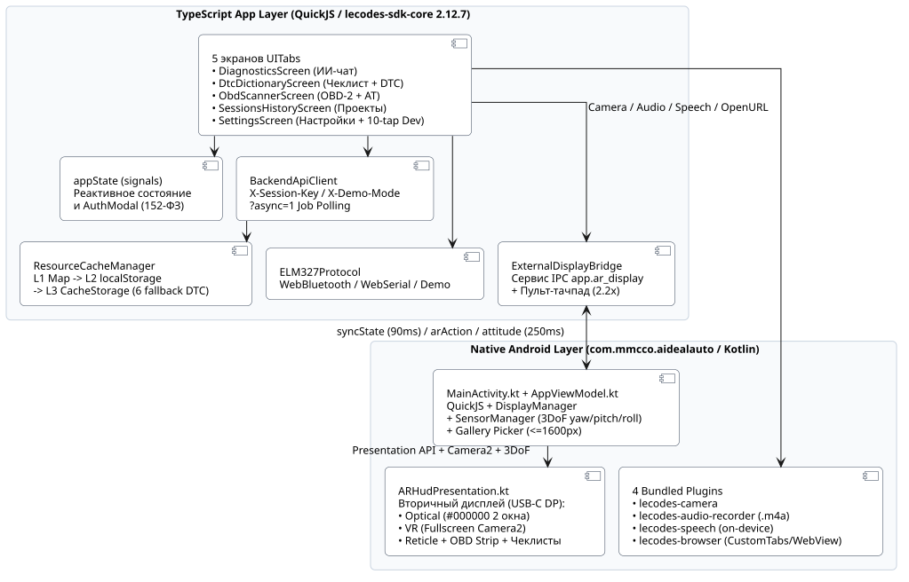

# «ИИдеал Авто» (AIdeal Auto) — Экспертная ИИ-система автодиагностики и пошагового ремонта

<p align="center">
  
</p>

> 📄 **PDF-версия документации:** [`docs/AIdeal_Auto_Documentation.pdf`](docs/AIdeal_Auto_Documentation.pdf) — полная иллюстрированная редакция технического руководства со схемами архитектуры, спецификациями сайта, нативного Android-приложения, AR HUD, ИИ-ядра и REST API.
> 📱 **Документация мобильного и кроссплатформенного клиента (`le.codes` / Android):** [`lecodes_webapp/README.md`](lecodes_webapp/README.md)

**«ИИдеал Авто» (AIdeal Auto)** — полностью автономная кроссплатформенная экспертная система для автосервисов, диагностов и автовладельцев. Система выполняет мультимодальную диагностику неисправностей автомобилей по текстовым жалобам, кодам ошибок OBD-II (DTC), телеметрии сканеров ELM327, логам и техническим документам, фотографиям узлов или приборной панели, а также нативным голосовым записям и аудиошумам двигателя, формируя структурированную технологическую карту ремонта с интерактивными чеклистами, допусками и моментами затяжки.

Система работает **полностью локально и автономно** (без внешних облачных LLM и без стороннего сервера `llama-server`) на базе послойного движка **AirLLM** с мультимодальной нейросетью **Google Gemma 4 12B Unified** (`google/gemma-4-12B-it-qat-w4a16-ct`), аппаратной автокалибровки GPU (**AutoTuner**), гибридного ядра **RAG v2** (**12 713** документов и **12 141** уникальный код DTC), нативного аудиовхода (`embed_audio` без Whisper), воркера памяти с окном **32K токенов** и изоляцией по пользователям, а также двух клиентских платформ: **адаптивного веб-сайта PWA** (с Web OBD-II и веб-AR HUD) и **нативного Android / `le.codes`-приложения** (с выводом AR HUD на внешний дисплей AR-очков и управлением с пульта-тачпада на смартфоне).

---

## Содержание

1. [Архитектура системы и потоки данных](#1-архитектура-системы-и-потоки-данных)
2. [Вычислительное ИИ-ядро: AirLLM, Gemma 4 12B W4A16 и AutoTuner](#2-вычислительное-ии-ядро-airllm-gemma-4-12b-w4a16-и-autotuner)
3. [Гибридный конвейер RAG v2 и база знаний (12 713 документов / 12 141 DTC)](#3-гибридный-конвейер-rag-v2-и-база-знаний-12-713-документов--12-141-dtc)
4. [Мультимодальный ввод, парсер документов, Pydantic-схемы и Function Calling](#4-мультимодальный-ввод-парсер-документов-pydantic-схемы-и-function-calling)
5. [Воркер контекстной памяти (32K), изоляция пользователей и база данных](#5-воркер-контекстной-памяти-32k-изоляция-пользователей-и-база-данных)
6. [Веб-сайт и PWA («ИИдеал Авто») — архитектура и все функции](#6-веб-сайт-и-pwa-иидеал-авто--архитектура-и-все-функции)
7. [Нативное Android- и кроссплатформенное приложение (`lecodes_webapp`) — архитектура и все функции](#7-нативное-android--и-кроссплатформенное-приложение-lecodes_webapp--архитектура-и-все-функции)
8. [Быстрый старт, развертывание, сборка APK и отладка в VS Code](#8-быстрый-старт-развертывание-сборка-apk-и-отладка-в-vs-code)
9. [Полная структура репозитория](#9-полная-структура-репозитория)
10. [Полный справочник маршрутов и REST API](#10-полный-справочник-маршрутов-и-rest-api)
11. [Тестирование, бенчмарки и лицензирование](#11-тестирование-бенчмарки-и-лицензирование)

---

## 1. Архитектура системы и потоки данных

Платформа построена по **четырехуровневой клиент-серверной архитектуре** с жесткой изоляцией пользовательских данных, неблокирующим фоновым воркером памяти и локальным GPU/DMA-инференсом:



| Уровень | Компоненты и файлы | Ответственность |
|---|---|---|
| **1. Клиентский уровень** | **Веб-сайт PWA** (`templates/diagnostics/*`, `static/js/app.js`, `obd2.js`, `sw.js`, `app.css`)<br>**Нативное приложение `le.codes` / Android** (`lecodes_webapp/main.ts`, `src/*`, `android/.../MainActivity.kt`, `ARHudPresentation.kt`) | Ввод симптомов, фото, аудио, документов; локальная диагностика OBD-II (BLE / USB Serial / Демо); офлайн-кэш словаря DTC; веб-AR HUD (`/ar/`) и аппаратный внешний AR-экран для очков RayNeo/XREAL/Rokid/Viture с пультом на смартфоне. |
| **2. Уровень оркестрации Django** | `autodiag_project/cors_middleware.py`, `settings.py`, `urls.py`<br>`diagnostics/views.py`, `models.py`, `context_worker.py`, `apps.py` | Проброс токена сессии (`X-Session-Key` / `Bearer`), динамический CORS, многопользовательская изоляция (`UserMemorySettings`, `DiagnosticProject`, `DialogSession`), гостевой RAM-демо-режим без записи в БД, асинхронные задачи (`?async=1`) и отмена генерации, предзагрузка модели на старте, фоновый воркер 32K памяти. |
| **3. Вычислительное ИИ-ядро и RAG** | `diagnostics/airllm_vulkan_service.py`, `autotune.py`, `schemas.py`, `voice_service.py`, `document_service.py`<br>`engine.py`, `vulkan_backend.py`, `prepare_airllm_model.py`, `scripts/ingest_external_rag.py` | Предобработка речи/шумов (16 кГц float32), разбор PDF/DOCX/XLSX/логов/фото, детерминированный Function Calling, гибридный RAG v2 (`MiniLM + FAISS + BM25 + 3-gram + CrossEncoder`), послойный инференс Gemma 4 12B (`W4A16 int4pack`), ремонт/валидация JSON Schema. |
| **4. Аппаратный уровень и периферия** | GPU CUDA/Vulkan + Page-Locked Pinned RAM<br>ELM327 OBD-II (BLE / USB-OTG Serial)<br>AR-очки (USB-C DisplayPort + 3DoF IMU) | Удержание до 27–36/48 слоев в VRAM, PCIe DMA-стриминг остальных слоев без OOM; чтение Mode 01/03/04/07/0A/0902; нативный вывод на вторичный дисплей Android + датчик `TYPE_ROTATION_VECTOR`. |

### Поток обработки диагностического запроса (`/api/ask/`)



1. Клиент (веб-сайт или нативное приложение с `?async=1`) отправляет текст, коды DTC, фото, аудио и/или документы на `POST /api/ask/`.
2. `CorsMiddleware` при наличии заголовка `X-Session-Key` (или `Authorization: Bearer <token>`) подставляет cookie сессии **до** запуска `SessionMiddleware`.
3. `api_ask_expert` проверяет права владения сессией (`_can_access_session`), мгновенно вытесняет активный воркер памяти (`preempt_if_running`, 0 мс), а в режиме `?async=1` немедленно возвращает HTTP `202 {job_id, status: "running"}` и запускает фоновый поток обработки.
4. `voice_service.py` и `document_service.py` декодируют аудио в 16 кГц моно `float32` + WAV, извлекают текст документов (`<= 25 000` символов полностью либо интеллектуальной выборкой) и встраиваемые изображения.
5. `AirLLMVulkanOrchestrator.execute_function_calls()` детерминированно вызывает инструменты `lookup_dtc_code`, `search_knowledge_base`, `inspect_attached_image`, `parse_uploaded_document`, `inspect_attached_audio`, `build_repair_inventory`, формируя проверенный контекст из RAG v2.
6. `_run_airllm_inference()` объединяет системный промпт, релевантные регламенты RAG, сводку `UserMemorySettings`, выжимку текущей сессии, последние 5 пар реплик (10 сообщений), тензоры изображений (`embed_vision`) и аудио (`embed_audio`) и запускает генерацию `AdaptiveAirLLMGemma4` под контролем `SmartDiagnosticStoppingCriteria`.
7. `validate_and_coerce_structured_json()` очищает служебные теги размышлений, при обрыве по тайм-лимиту ремонтирует усеченный JSON по стеку скобок, обрезает текст по границе последнего завершенного предложения (`truncate_to_last_sentence`) и валидирует результат через **Pydantic v2** и **JSON Schema**.
8. Для авторизованного пользователя ответы сохраняются в `ChatMessage` (все вложения — в виде `data:<mime>;base64,...` внутри БД), после чего запускается фоновый `context_worker_manager.start_background_update(session_id)`.

---

## 2. Вычислительное ИИ-ядро: AirLLM, Gemma 4 12B W4A16 и AutoTuner

### 2.1. Архитектура модели и нарезка на 52 шарда

В модулях [`diagnostics/airllm_vulkan_service.py`](diagnostics/airllm_vulkan_service.py) и [`prepare_airllm_model.py`](prepare_airllm_model.py) используется мультимодальная модель **`google/gemma-4-12B-it-qat-w4a16-ct`** (`Gemma4UnifiedForConditionalGeneration`, локально в `models/gemma-4-12B-it/`):

- **Параметры текстового декодера (`models/gemma-4-12B-it/config.json`)**: `hidden_size = 3840`, `intermediate_size = 15360`, `vocab_size = 262144`, `max_position_embeddings = 262144`, `tie_word_embeddings = true` (`lm_head.weight` связан с `embed_tokens.weight`).
- **48 декодер-слоев с гибридным вниманием**: чередующийся паттерн `5 × sliding_attention` (`sliding_window = 1024`, 16 голов Q / 8 голов KV, `head_dim = 256`) + `1 × full_attention` (слои `5, 11, 17, 23, 29, 35, 41, 47`; 1 глобальная KV-голова, `global_head_dim = 512`).
- **Мультимодальные проекторы**: Vision (`gemma4_unified_vision`, `mm_embed_dim = 3840`, `num_soft_tokens = 280`, `patch_size = 16`, `pooling_kernel_size = 3`) и Audio (`gemma4_unified_audio`, `audio_embed_dim = 640`, `audio_token_id = 258881`).
- **Квантование весов**: W4A16 (`4-bit` упакованные веса, `group_size = 32`, ~7.54 ГБ суммарно), параметры квантования вынесены в `w4a16_quant_config.json` при санитизации `config.json`, что устраняет зависимость рантайма от пакета `compressed-tensors`.
- **52 независимых шарда safetensors** в `models/airllm_shards/splitted_model/` (с маркерами `.done` и `model.safetensors.index.json` на `1005` записей):
  - `model.language_model.embed_tokens` (~2.01 ГБ)
  - `model.language_model.layers.0` .. `layers.47` (~126.1 МБ sliding / ~136.1 МБ full-attention)
  - `model.language_model.norm` (~7.8 КБ)
  - `model.embed_vision` (~99.8 МБ)
  - `model.embed_audio` (~4.9 МБ)

### 2.2. Движок `AdaptiveAirLLMGemma4`, ядра `W4A16Linear` (`int4pack`) и DMA-стриминг

Класс `AdaptiveAirLLMGemma4` наследуется от `airllm.airllm_base.AirLLMBaseModel` (`dtype=torch.bfloat16` на CUDA, `max_seq_len=32768`, `prefetching=False` в базовом классе — заменено собственным оптимизированным конвейером):

1. **Замена линейных слоев на `W4A16Linear`**: все `nn.Linear` внутри 48 декодер-слоев заменяются на `W4A16Linear(group_size=32)`.
2. **Аппаратное ускорение `int4pack`**: метод `prepare_int4pack()` на CUDA (при `out_features % 8 == 0`, `in_features % 64 == 0`) переставляет 4-битные нибблы (`((wp_u8 & 0x0F) << 4) | (wp_u8 >> 4)`), упаковывает веса через `torch._convert_weight_to_int4pack(..., 2)` и исполняет матричное умножение через нативное тензорное ядро **`torch.ops.aten._weight_int4pack_mm`** в `bfloat16` (без ручной распаковки на каждом шаге). На CPU или нестандартных размерностях работает fallback-распаковка.
3. **Резидентное закрепление в VRAM**: `embed_tokens`, `norm`, `embed_vision` и `embed_audio` закрепляются в VRAM навсегда, а декодер-слои `layers.0..47` загружаются в VRAM до тех пор, пока остаток свободной памяти превышает страховочный порог `VRAM_HEADROOM_MB` (по умолчанию `1152` МБ) и лимит `VULKAN_GPU_LAYERS` / `AIRLLM_GPU_LAYERS`.
4. **Асинхронный PCIe DMA Prefetch**: слои, не поместившиеся в VRAM (`_streamed_indices`), один раз конвертируются в `int4pack` и переносятся в **page-locked pinned RAM** (`pin_memory()`). Отдельный CUDA-стрим `_prefetch_stream` по кольцевой карте `_next_streamed_map` асинхронно подгружает следующий слой (`non_blocking=True`) во время вычисления текущего, а `_post_hook` мгновенно сбрасывает ссылки на `meta`, предотвращая OOM.
5. **Динамическая миграция слоев**: метод `set_resident_layer_count(target_count)` перемещает слои между GPU VRAM и pinned RAM «на лету» без повторного чтения `.safetensors` с диска.

### 2.3. Автокалибровка оборудования (`diagnostics/autotune.py`) и `vulkan_backend.py`

При старте сервера (если не заданы `AUTODIAG_FAST_TEST=1` или `AIRLLM_SKIP_AUTOTUNE=1`) запускается модуль [`diagnostics/autotune.py`](diagnostics/autotune.py):

- **WDDM-устойчивая оценка VRAM**: `_get_usable_free_vram_mb()` суммирует физически свободную память CUDA и неиспользованный кэш аллокатора PyTorch `(mem_get_info(0)[0] + max(0, memory_reserved(0) - memory_allocated(0))) // 1024²`, избегая ложных нулей под Windows WDDM.
- **Кэширование профиля**: профиль сохраняется в `models/airllm_shards/autotune_profile.json` (исключен в `.gitignore` под конкретный ПК) и переиспользуется, если совпадают `schema_version == 2`, `gpu_name`, `vram_total_mb` (±256 МБ), квантованный с шагом `512 МБ` `vram_free_bucket_mb` (±1024 МБ) и `target_sla_sec` (по умолчанию `55.0` сек). Принудительная перекалибровка — `AIRLLM_RECALIBRATE=1`.
- **Алгоритм калибровки**: прогрев (2 токена) -> базовый замер (6 токенов) -> **понижение слоев** (`-2` слоя за шаг, до 4 шагов) при обнаружении свопинга WDDM (`free < 350 МБ` или `decode_tps < 0.7`) -> **повышение слоев** (`+2` слоя за шаг, до 6 шагов) пока улучшается скорость `>= +1%` и остается `>= 450 МБ` свободной VRAM -> финальный замер (8 токенов) и расчет параметров под целевой SLA:
  - Режим размышлений (`enable_thinking=True`) включается только на быстрых GPU при `decode_tps >= 17.0` и `raw_diag_budget >= 850` (с надбавкой `+160` токенов, максимум `1150`).
  - На эталонной видеокарте **NVIDIA GeForce RTX 3050 (8 ГБ VRAM)** зафиксирован откалиброванный профиль (`autotune_profile.json`): `optimal_gpu_layers = 27` (21 стримится по DMA), `prefill_ms = 3941 мс`, `decode_tps = 2.81 ток/с`, `min_free_vram_mb = 948 МБ`, `compact_json = true`, `max_new_tokens_diag = 230`, `max_new_tokens_followup = 180`, `max_new_tokens_greeting = 95`, `rag_top_n = 2`, `max_memory_chars = 650`.
- **Модуль [`vulkan_backend.py`](vulkan_backend.py)**: проверяет библиотеку `vulkan-1.dll` / `libvulkan.so.1`, парсит `vulkaninfo --summary`, вычисляет резерв KV-кэша (под контекст 32K и ответ до 5000 токенов) через `compute_adaptive_vram_allocation()` и инициализирует переменные окружения (`GGML_VULKAN=1`, `PYTORCH_CUDA_ALLOC_CONF`, `LLM_CTX_SIZE=32768`).

### 2.4. Управление остановкой генерации и очистка рассуждений

- В `eos_ids` передаются `[1, 106, 105]` (`<eos>`, `<turn|>`, `<|turn`). Токены `101` (`<channel|>`) и `107` намеренно исключены из EOS, чтобы модель не обрывала генерацию сразу после блока рассуждений.
- `SmartDiagnosticStoppingCriteria` останавливает инференс по событию отмены `cancel_event`, по SLA-таймауту (`profile.max_time_sec_*`, а для изображений минимум `260.0` сек) или досрочно, как только после `>= 45` новых токенов успешно парсится завершенный JSON-блок ```` ```json {...} ``` ````.
- Регулярные выражения в `airllm_vulkan_service.py` и `schemas.py` вырезают внутренние блоки `<|channel>thought.*?<channel|>`, `<think>.*?</think>`, префикс `thought\n...` и управляющие теги Gemma 4.

---

## 3. Гибридный конвейер RAG v2 и база знаний (12 713 документов / 12 141 DTC)

В модулях [`engine.py`](engine.py) и [`scripts/ingest_external_rag.py`](scripts/ingest_external_rag.py) реализована трехуровневая база знаний и высокоскоростной гибридный поиск:

### 3.1. Трехуровневый корпус знаний и аудит источников

| Уровень (Tier) | Источник | Объем и характеристики |
|---|---|---|
| **Tier 1 (Эталон RU)** | [`kb_data.json`](kb_data.json) + [`VehicleDiagnosticSample.txt`](VehicleDiagnosticSample.txt) | **137** курируемых русскоязычных регламентов (`engine: 63`, `electrical: 22`, `transmission: 18`, `brakes: 11`, `cooling: 6`, `battery: 5`, `suspension: 5`, `chassis: 4`, `hybrid: 3`) + **222** синтетических блока из **1 209** записей телеметрии (`32 732` строки), формирующих **36** эталонных профилей параметров PID (`telemetry_stats`). Русскоязычные поля Tier 1 защищены от перезаписи внешними данными. |
| **Tier 2 и Tier 3 (External KB)** | [`data/kb_external.jsonl.gz`](data/kb_external.jsonl.gz) (522 КБ) и [`data/rag_manifest.json`](data/rag_manifest.json) | **12 354** очищенных записи (**117** Tier 2 + **12 237** Tier 3), **12 128** уникальных валидных OBD-II кодов, **134** общих/не-OBD регламента. Отражены все 9 систем (`engine: 4784`, `electrical: 2129`, `transmission: 1550`, `chassis: 889`, `hybrid: 778`, `battery: 698`, `cooling: 649`, `brakes: 641`, `suspension: 236`). |
| **Итоговый индекс** | `VehicleExpertEngine` (`engine.py`) | **12 713 документов** (`raw_data`) и **12 141 уникальный код DTC** в каталоге `dtc_catalog` (Tier 1: `137`, Tier 2: `49`, Tier 3: `11 955`). |

При генерации внешнего корпуса скриптом [`scripts/ingest_external_rag.py`](scripts/ingest_external_rag.py) были проверены и проиндексированы **5 открытых наборов данных**:
1. **`xsvdevelopment/commonmanual`** (`CC-BY-SA-4.0` / `MIT`): **12 163** записи (`12 127` кодов: `9 342` generic + `2 785` синтезированных OEM-only, `104` обогащено из `generic-powertrain.json`; а также `36` статей KB: `23` known-issues и `13` процедур).
2. **`MechanicDB/MechanicDB-public`** (`ODbL-1.0` / `MIT` / `CC-BY-4.0`): **190** записей (`90` OBD-II Tier 2 с ранжированными способами ремонта, запчастями, сложностью и нормо-часами `est_labor_hours`; `100` грузовых кодов J1939 SPN/FMI Tier 3).
3. **`karsonmadden/us-vehicle-trouble-codes`** (`CC-BY-4.0`): обработано `1 142` строки — обогащены статистикой бюллетеней NHTSA (`nhtsa_bulletins`) и жалоб владельцев (`nhtsa_owner_reports`) `838` записей CommonManual и `68` записей MechanicDB + `1` самостоятельная запись (`303` пропущены из-за пустого поля `meaning`).
4. **`RRK1987/automotive-diagnostics-v2`** (`MIT`): проаудировано `100` строк валидатором `validate_rrk1987_row` — **0 принято, 100 отклонено** (`placeholder_dtc: 40`, `contradictory_ecu_dtc_mapping: 35`, `synthetic_truncated_noise: 25`).
5. **`GITheMan/vehicle-repair-manuals`** (`MIT`): репозиторий проаудирован, содержит 0 файлов руководств (`skipped_empty_upstream_repository`).

### 3.2. Конвейер поиска, формула ранжирования и замеры точности

1. **Двуязычный токенизатор `tokenize_multilingual`**: выделяет `[a-zа-яё0-9]+`, сохраняет важные английские диагностические термины (`sensor`, `circuit`, `misfire`, `lean`, `rich`, `pressure`, `can`, `abs` и др.) и формирует легкие основы (stems) для RU (`>= 6` букв -> 5-символьный префикс) и EN (`-ies -> -y`, `-ing`, `-ed`, `-s`).
2. **O(1) фильтр приветствий и оффтопа (`is_general_or_greeting_query`)**: проверяет паттерны приветствий и пересечение токенов с предвычисленным словарем `_all_kb_vocab` без итерации по массиву документов.
3. **Векторный + лексический отбор (30 + 30 + O(1) DTC)**:
   - Bi-Encoder `sentence-transformers/paraphrase-multilingual-MiniLM-L12-v2` (384-мерные L2-нормализованные векторы) + индекс **`faiss.IndexFlatIP(384)`** -> **Топ-30** семантических кандидатов. Эмбеддинги кэшируются в `models/rag_cache/embeddings_<sha256[:16]>.npy` (на диске: матрица `(12713, 384)` `float32`).
   - **`BM25Okapi`** -> **Топ-30** лексических кандидатов + мгновенный индекс `_code_to_doc_indices[code]`.
   - Ленивый подсчет символьных 3-грамм (`_LazyDocNgrams`) только для объединения кандидатов и вычисление лексико-триграммного скора с бустингом совпадения кода DTC (`+2.5`). Сбалансированный пул объединяет **до 20 кандидатов**.
4. **Попарный реранкинг и учет критичности узла**:
   - **`cross-encoder/mmarco-mMiniLMv2-L12-H384-v1`** оценивает пары `[query, doc[:480]]` через сигмоиду `ce_prob`.
   - Формула остаточного ресурса узла: $\text{health\_bonus} = \frac{100 - \text{health\_index}}{200}$.
   - Бонус уровня достоверности (`tier_bonus`): `0.09` (`kb_data.json`), `0.07` (Tier 1), `0.02` (Tier 2), `0.0` (Tier 3).
   - Итоговый скор: `0.45 * ce_prob + 0.40 * lex + 0.15 * vec + 0.25 * health_bonus + code_bonus + tier_bonus`.

**Результаты замеров [`evaluate_model.py`](evaluate_model.py) на корпусе 12 713 документов (NVIDIA GeForce RTX 3050):**

| Бенчмарк | Recall@3 | MRR | Cold Latency | Warm Latency |
|---|---|---|---|---|
| **Основной эталон Tier 1 (RU, 7 кейсов)** | **100.0%** | **1.000** | `671.40 мс` | `601.87 мс` |
| **Внешний Smoke-тест (EN + Tier ≥ 2, 5 кейсов)** | **100.0%** | **1.000** | `577.96 мс` | — |

---

## 4. Мультимодальный ввод, парсер документов, Pydantic-схемы и Function Calling

### 4.1. Нативный аудиовход без Whisper (`diagnostics/voice_service.py`)

Внешние модели распознавания речи (Whisper) полностью исключены. Модуль [`diagnostics/voice_service.py`](diagnostics/voice_service.py) подготавливает аудио напрямую для аудиопроектора **`model.embed_audio`** в Google Gemma 4 12B:
- Декодирует через **PyAV (`av`, биндинги FFmpeg в памяти)** форматы `.wav`, `.mp3`, `.ogg`, `.m4a`, `.mp4`, `.3gp`, `.amr`, `.flac`, `.webm`, `.aac`, `.opus`, `.wma` (с резервным парсером PCM WAV на `wave` для 8/16/32-битных файлов).
- Передискретизирует в **16 кГц моно `float32`** (лимит длительности `MAX_AUDIO_SECONDS = 45.0` сек / 720 000 сэмплов), удаляет постоянную составляющую (DC offset), нормирует пиковую амплитуду к `0.75` и ограничивает к `[-1.0, 1.0]`.
- Функция `waveform_to_wav_bytes()` формирует 16-битный PCM WAV (используется в `/api/transcode-audio/` и `/api/ask/` для гарантированного воспроизведения во всех браузерах).

### 4.2. Универсальный парсер документов (`diagnostics/document_service.py`) и хранение в БД

Все вложения (фотографии узлов, снимки камеры, аудиозаписи, логи и документы) сохраняются **непосредственно в поле `ChatMessage.attachments` базы данных SQLite в формате `data:<mime>;base64,...`**, без создания временных файлов в `media/`:

- **Поддерживаемые типы файлов**:
  - **Текст и логи ЭБУ**: `.txt`, `.log`, `.md`, `.obd`, `.ini`, `.cfg`, `.conf`, `.yaml`, `.yml`.
  - **Структурированные таблицы и разметка**: `.json`, `.csv`, `.tsv` (до 300 строк), `.xlsx` (до 4 листов, 120 строк на лист), `.xml`, `.html`, `.htm`, `.rtf`.
  - **Документы со встроенными изображениями**: `.pdf` (`pypdf`, до 40 страниц и до 6 встроенных изображений) и `.docx` (`python-docx`, текст + до 10 таблиц × 40 строк + до 6 изображений из `word/media/`).
  - **Изображения**: `.jpg`, `.jpeg`, `.png`, `.webp`, `.bmp`, `.gif`, `.tiff`, `.tif`, `.avif`, `.jfif` — масштабируются до `<= 1024 px` (JPEG q=85), а `analyze_image_bytes()` дополнительно анализирует гистограмму (темный/красный/янтарный/металлический фон для распознавания индикаторов приборной панели или подкапотного пространства). В Gemma 4 Vision одновременно передается до 4 изображений (`(640, 640)` для фото и `(768, 768)` для иллюстраций из PDF/DOCX).
- **Умная выборка крупных файлов (`MAX_FULL_DOC_CHARS = 25000`)**: документы до 25 000 символов передаются в промпт на `100%` (`processing_mode = "full"`); более крупные логи проходят `_smart_sample_document_text()` (`smart_sampled`: заголовок `<= 4500` симв. + строки с диагностическими/DTC-паттернами `<= 14000` симв. + хвост `<= 4500` симв.). Автоматически извлекаются коды `[PCBU][0-9A-F]{4}` и до 12 ключевых метрик вида `key=value`.

### 4.3. Pydantic v2 схемы, ремонт JSON и Function Calling

Модуль [`diagnostics/schemas.py`](diagnostics/schemas.py) обеспечивает строгую типизацию ответа (`DiagnosticStructuredResponse`, валидация через `jsonschema.validate`):
- Поля ответа: `response_type` (`"diagnosis" | "followup" | "visual_inspection" | "general"`), `summary_title`, `mentor_reply`, `faults` (`DetectedFault[]` с `severity`, `confidence`, `health_index`, `root_cause`), `inventory` (`InventoryItem[]`), `repair_steps` (`RepairTaskStep[]` с `torque_or_spec`, `safety_warning`, `verification_hint`, `estimated_minutes`), `telemetry_notes`, `recommendations`, `follow_up_question`, `tool_calls`, `vehicle_detected`.
- **Восстановление усеченного JSON (`_repair_truncated_json`)**: при прерывании ответа по лимиту токенов или SLA-таймауту сканер отслеживает глубину стека `{`/`[`, перебирает до 24 последних безопасных точек отсечения, закрывает открытые скобки и сохраняет валидную часть карточек и шагов, отбрасывая только оборванные элементы.
- **Автообрезка по предложениям (`truncate_to_last_sentence`)**: обрезает `mentor_reply` по последнему знаку завершения предложения (игнорируя десятичные дроби вроде `12.6` В) и убирает висящие русские предлоги/союзы (`DANGLING_WORDS_RU`).
- **Инструменты (Function Calling)**:
  - OpenAI-совместимые описания (`DIAGNOSTIC_TOOLS_OPENAI_FORMAT`): `lookup_dtc_code`, `search_knowledge_base`, `build_repair_inventory`.
  - Детерминированные вызовы в `AirLLMVulkanOrchestrator.execute_function_calls()` (6 типов записей `ToolCallExecution`): `lookup_dtc_code`, `search_knowledge_base`, `inspect_attached_image`, `parse_uploaded_document`, `inspect_attached_audio`, `build_repair_inventory` (с заполнением номенклатуры из шаблонов `SYSTEM_INVENTORY_TEMPLATES` для 9 систем автомобиля).
- **Режим быстрых тестов и отказоустойчивость**: при `AUTODIAG_FAST_TEST=1` (или при ошибке инференса GPU) `diagnose_and_respond()` формирует детерминированный структурированный ответ `_build_diagnostic_scaffolding()` на базе реального RAG-поиска и словаря DTC.

---

## 5. Воркер контекстной памяти (32K), изоляция пользователей и база данных

### 5.1. Динамический воркер контекста (`diagnostics/context_worker.py`)

- **Оперативная память диалога**: в рабочий промпт напрямую передаются последние **5 пользовательских и 5 ассистентских реплик** (`RECENT_EXCHANGES_TO_KEEP = 5`, итого 10 сообщений) с очищенной выжимкой шагов и неисправностей (`format_assistant_core_memory`).
- **Динамический бюджет окна 32K**: функция `compute_dynamic_context_budget()` резервирует `1800` токенов под системный промпт/RAG и `5000` под генерацию ответа, вычитает токены 10 свежих сообщений и отводит `35%` остатка под выжимку (`summary_token_budget` в диапазоне `400..6000` токенов -> `1200..14000` символов, коэффициент детализации `scale_factor = 1..3`).
- **Вытеснение за 0 мс (Zero-Wait Preemption)**: при новом запросе `preempt_if_running(session_id)` устанавливает `cancel_event.set()` и атомарно увеличивает `worker_version` со статусом `"aborted_for_priority"` без ожидания завершения фонового потока (`join` не вызывается). Устаревший поток перед записью в БД проверяет совпадение `worker_version`.

### 5.2. Многопользовательская изоляция, миграция 0004 и гостевой режим



- **Полная изоляция между аккаунтами**:
  - Настройки кросс-диалоговой памяти вынесены из глобального синглтона `SystemSettings` в персональную модель **`UserMemorySettings`** (`OneToOneField` на `auth.User`, поля `cross_dialog_memory_enabled`, `global_memory_summary`, `memory_cleared_at`). Миграция `0004` очистила устаревшие общие сводки.
  - Все обновления памяти защищены индивидуальными блокировками `_user_memory_locks[user_id]` (`threading.RLock`), а агрегация сводок (`<= 6` последних сессий пользователя) учитывает метку `memory_cleared_at`.
  - Функция `_can_access_session(request, session)` строго запрещает доступ к чужим проектам, сессиям, сообщениям, задачам воркера и асинхронным джобам `job_id` (HTTP `403`).
- **Гостевой Демо-режим (без авторизации)**:
  - При входе без аккаунта (или с заголовком `X-Demo-Mode: 1`) сессия создается в оперативной памяти, история передается клиентом (`demo_history`, до 10 реплик), а сообщения ассистента для работы чеклистов кэшируются только в RAM-пуле `_DEMO_RAM_MESSAGES` (лимит `60` записей, ID от `900001`). **В SQLite не записывается ни одной строки**.
- **Инициализация БД из `db_clean.sqlite3`**:
  - Рабочая БД `db.sqlite3` исключена из git. При первом импорте `settings.py`, если `db.sqlite3` отсутствует, автоматически копируется эталонная база **`db_clean.sqlite3`** со всеми миграциями и двумя предсозданными учетными записями:
    - **Администратор**: логин `admin`, пароль `AIdealAutoAdmin2026!` (админ-панель `/admin/`).
    - **Тестовый механик**: логин `mechanic`, пароль `Mechanic2026!`.

---

## 6. Веб-сайт и PWA («ИИдеал Авто») — архитектура и все функции

### Сравнительная матрица функций: Веб-сайт (PWA) vs Нативное приложение (`le.codes` / Android)

| Возможность / Подсистема | Веб-сайт (PWA, `templates/` + `static/`) | Приложение (`lecodes_webapp`: Android / Desktop / Web) |
|---|---|---|
| **Среда исполнения UI** | Vanilla JS/CSS/HTML, Service Worker `aideal-auto-v7` | Нативные компоненты `le.codes` (`UITabs`, `UIColumn`, `UICameraNode`), движок **QuickJS** на Android |
| **Авторизация и изоляция** | Сессионные cookies + CSRF, вход/регистрация/удаление аккаунта, RAM Демо-режим, 152-ФЗ | Заголовок **`X-Session-Key`** + `X-Demo-Mode: 1`, вход/регистрация/удаление аккаунта, модал согласия 152-ФЗ при первом запуске |
| **Запросы к ИИ-ядру** | `POST /api/ask/` (Multipart/JSON), Optimistic UI, 4-стадийный прогресс, отмена `/api/cancel/` | Неблокирующий **`POST /api/ask/?async=1`** -> HTTP `202` + опрос `GET /api/ask/job/<id>/` каждые `1.5 с` (до `15 мин`) + отмена |
| **Голосовой ввод и аудио** | Прямой захват **16-bit PCM WAV** (`ScriptProcessorNode`) + `SpeechRecognition` (`ru-RU`) + 28-полосная радиальная спектрограмма + плеер с Web Audio API fallback | Нативный плагин `lecodes-audio-recorder` (`.m4a`, уровень каждые `100 мс`) -> `/api/transcode-audio/` + резерв `lecodes-speech` (on-device `SpeechRecognizer`) |
| **Камера и документы** | Камера `1280×720` с сеткой, лайтбокс, парсер `/api/preview-document/`, инспектор извлеченного промпта и картинок из PDF/DOCX | Нативный `lecodes-camera` (`UICameraNode`) + системная галерея (`<= 1600 px`), авто-извлечение до 6 DTC из документов |
| **Сканер OBD-II (ELM327)** | Web Bluetooth (4 UUID-группы), Web Serial (`38400`), Демо ЭБУ; 4 живых датчика (опрос `600 мс`), Mode 03/07/0A, VIN `0902` | `ELM327Protocol`: BLE (8 UUID), USB Serial (`38400–500000` бод, FTDI/CH340/CP2102/PL2303/Tactrix), Демо ЭБУ; **6 живых датчиков** (`450 мс`), Mode 03, **сброс Mode 04**, VIN `0902`, **AT-терминал** |
| **Словарь DTC и офлайн-кэш** | `GET /api/dtc/` (по 80 шт., OEM + NHTSA TSB); кэш `/api/dtc/` в Service Worker (`CacheStorage`) | 3-уровневый кэш **L1 Map -> L2 `localStorage` -> L3 `CacheStorage`** (`aideal-lecodes-cache-v1`), синхронизация до `1000` кодов + 6 базовых кодов + синтез по шаблону `[PCBU][0-9A-F]{4}` |
| **AR / VR HUD** | Веб-режим `/ar/`: **RayNeo Optical** (`#000000`) и **Video Passthrough**, перетаскиваемые окна, `#arStagingBar`, выбор/создание сессий, Portrait Barrier | **Нативный `ARHudPresentation.kt`** на внешнем дисплее AR-очков (USB-C DP: RayNeo, XREAL, Rokid, Viture) + **3DoF (`yaw/pitch/roll`)** + **Пульт-тачпад (`2.2×`) на телефоне** + локальный AR/VR HUD при отсутствии очков |
| **Отладка подключения** | Относительный origin Django (`/`) | **Скрытое Инженерное меню** (10 тапов по версии в «Настройках»): пресеты `localhost:8000` / `10.0.2.2:8000`, LAN URL, Ping-тест с замером мс |

---

Веб-интерфейс реализован на ванильном JS/CSS/HTML без тяжелых фронтенд-фреймворков ([`templates/diagnostics/index.html`](templates/diagnostics/index.html), [`static/js/app.js`](static/js/app.js), [`static/js/obd2.js`](static/js/obd2.js), [`static/js/sw.js`](static/js/sw.js), [`static/css/app.css`](static/css/app.css)).

### 6.1. Адаптивная верстка, темы и PWA-офлайн

- **Три режима раскладки**:
  - **Desktop (`> 1120px`)**: трехколоночная сетка `290px 1fr 370px` — слева дерево проектов/сессий и карта воркера памяти (`#panelSidebar`), в центре лента диагностики и панель ввода (`#panelMain`), справа инспектор чеклистов и словаря DTC (`#panelInspector`).
  - **Планшет (`<= 1120px`)**: двухколоночная сетка `250px 1fr`, инспектор открывается выдвижной шторкой.
  - **Смартфон (`<= 768px`)**: одноколоночный режим, левый сайдбар убирается в off-canvas шторку, снизу появляется панель навигации `.mobile-bottom-nav` (3 вкладки: «Диагноз», «Чеклист», «Коды DTC»), панель ввода перестраивается в двухрядную компоновку.
- **Оформление**: темная тема **Carbon Slate** (`#090d16`, оранжевый `#f97316` и голубой `#38bdf8` акценты) и светлая тема (`data-theme="light"`, переключатель `#btnToggleTheme`), шрифты `Inter`, `Fira Code`, `Share Tech Mono`, поддержка `prefers-reduced-motion`.
- **PWA и Service Worker (`aideal-auto-v7`)**: динамический `/manifest.json` (`display: standalone`, `orientation: any`, ярлыки `/` и `/ar/`). `sw.js` применяет стратегию **Network-First** для HTML и статики, **Network-Only** для `/api/auth/`, `/api/sessions/`, `/api/settings/`, `/api/worker-status/` (исключая утечку чужих данных из кэша) и **Network-First с параметризованным офлайн-кэшем** для `/api/dtc/?q=...`.

### 6.2. Полный перечень функций веб-сайта

1. **Авторизация, аккаунт и правовые документы (152-ФЗ)**:
   - Единое модальное окно входа/регистрации (`#authModal`) с обязательным чекбоксом согласия на обработку данных (`/terms/`, `/privacy/`) при регистрации и первом входе, баннер Cookies (`#cookieBanner`), полное удаление аккаунта и данных (`#btnDeleteAccount` -> `POST /api/auth/delete-account/`), очистка клиентского `localStorage`/`sessionStorage` при смене пользователя (`resetClientAccountAndMemoryState`).
2. **Управление проектами, диалогами и памятью**:
   - Создание/переименование/удаление папок проектов (`DiagnosticProject`); создание сессий, закрепление (Pin), назначение цветных тегов агрегатов (`ДВС`, `АКПП`, `Электрика`, `Тормоза`, `Подвеска`, `CAN-шина` + фильтр по тегам в сайдбаре), ввод и автосохранение автомобиля/VIN (`#vehicleInfoInput`), переименование диалога.
   - Одиночное (`.btn-delete-msg`) и пакетное удаление сообщений (`#chatSelectionToolbar`: выделение чекбоксами, «Выбрать все», «Удалить выбранные», «Очистить чат`) с синхронным пересчетом выжимки.
   - Просмотр статуса фонового воркера (`#sidebarWorkerBadge`, опрос каждые `650 мс`) и ручное редактирование выжимки сессии (`#dialogSummaryTextarea`) и кросс-диалоговой памяти (`#settingsModal`).
3. **Интеллектуальный чат, Optimistic UI и интерактивные чеклисты**:
   - Стартовая карточка с 5 быстрыми диагностическими сценариями (`P0300`, `P0796`, `C0050`, `U1900`, `C1731`).
   - Мгновенный **Optimistic UI** (карточка пользователя появляется до ответа сервера) + анимированная карточка генерации `createPendingGenerationCard()` с таймером `0.0 с`, 4 стадиями прогресса (`0s / 1.5s / 4.5s / 11s`) и кнопкой отмены генерации (`AbortController` + `POST /api/cancel/`).
   - Структурированный рендер карточек неисправностей (`health-bar-fill`, DTC-чипы, уверенность %), интерактивных чеклистов **Инвентаря** и **Шагов ремонта** (с моментами затяжки, временем и предупреждениями безопасности; клик синхронизируется по `/api/messages/<id>/toggle-task/` сразу в чате, правом инспекторе и AR HUD), кнопок уточняющих вопросов (`.btn-followup-chip`), копирования в буфер и экспорта заказ-наряда в `.txt`.
4. **Мультимодальные инструменты (камера, голос, инспектор документов)**:
   - **Камера (`#cameraModal`)**: видеопоток `1280×720`, прицельная сетка `.hud-reticle`, переключение тыловой/фронтальной камеры, фотосъемка в JPEG (`0.88`), просмотр фото в лайтбоксе (`#imageLightboxModal`).
   - **Прямая запись звука и плеер**: захват микрофона через `ScriptProcessorNode` напрямую в **16-битный моно PCM WAV** (с резервом `MediaRecorder`) + параллельный живой превью-транскрипт через `SpeechRecognition` (`ru-RU`) + радиальная 28-полосная спектрограмма вокруг кнопки микрофона (`#micSpectrogramCanvas`) + транскодирование `/api/transcode-audio/`. Встроенный аудиоплеер поддерживает перемотку ползунком и **резервный движок Web Audio API** (`AudioBufferSourceNode`) при отказе `<audio>`.
   - **Инспектор документов (`#documentPreviewModal`)**: предпросмотр загруженных файлов через `/api/preview-document/` (или локальный fallback `FileReader`) с отображением режима обработки (`100%` / `Выборка`), числа символов, найденных кодов DTC, извлеченных иллюстраций из PDF/DOCX и точного текста, отправляемого в промпт модели.
5. **Словарь кодов DTC (`#paneDtc`)**:
   - Живой поиск с debounce `180 мс`, фильтрация по системам авто, пагинация по 80 кодов («Загрузить еще»), отображение OEM-расшифровок по маркам, счетчика бюллетеней NHTSA TSB и кнопка `+ В запрос` для быстрого добавления кода в стейджинг.
6. **Веб-подсистема OBD-II (`static/js/obd2.js` + `#obdModal`)**:
   - Поддержка **Web Bluetooth API** (`0xfff0`, `0xffe0`, Nordic UART `6e400001`, OBDLink `0x18f0` с 20-байтным чанкингом), **Web Serial API** (`38400 8N1`) и **Демо-симулятора ЭБУ** (`ELM327 v1.5`).
   - Опрос живых параметров Mode 01 каждые `600 мс` (в UI отображаются RPM, скорость, температура ОЖ, дроссель; в `LIVE_PIDS` также определены нагрузка ДВС, температура впуска и напряжение ЭБУ), считывание кодов ошибок **Mode 03 / 07 / 0A** с автоматическим добавлением в стейджинг ИИ-чата, чтение **VIN (Mode 09 02)** с подстановкой в профиль авто `#vehicleInfoInput`, программная поддержка сброса `clearDtcCodes` (Mode 04 с обязательным флагом подтверждения).
7. **Двухрежимный веб-AR HUD (`/ar/` и `#btnEnterArMode`)**:
   - **Подрежим 1 — «RayNeo Optical»**: оптический черный фон `#000000` (прозрачный на Micro-OLED экранах очков), перетаскиваемые плавающие окна визира камеры (`#arWindowCamera`) и ИИ-ассистента (`#arWindowAssistant`).
   - **Подрежим 2 — «Камера-фон (Video Passthrough)»**: полноэкранный живой видеопоток камеры на фоне (`#arBgVideoEl`) с кнопкой смены камеры (`#btnArSwitchBgCamera`) и полупрозрачным стеклом окна ассистента; внутреннее окно камеры скрывается.
   - Портретный барьер (`#arPortraitBarrier`) в вертикальной ориентации; переключение и создание сессий прямо из AR (`#arSessionSelect`, `#btnArNewSession`); панель стейджинга (`#arStagingBar`); кнопки быстрого снимка в стейджинг (`#btnArSnapInAssistant`), сброса позиций окон (`#btnArResetLayout`), полного экрана и голосового ввода.

---

## 7. Нативное Android- и кроссплатформенное приложение (`lecodes_webapp`) — архитектура и все функции

Нативный клиент [`lecodes_webapp`](lecodes_webapp/) создан на **TypeScript** поверх SDK **`le.codes`** (`lecodes-cli@^2.14.3`, Android Runtime **`io.letary:lecodes-sdk-core:2.12.7@aar`**), исполняющего скомпилированный бандл `app.js` на движке **QuickJS** без внешнего WebView. Приложение собирается под **Android (`com.mmcco.aidealauto`)**, **Desktop (`1280×840`)** и **Web**.



### 7.1. Ядро приложения, кэширование и асинхронный API-клиент

- **Реактивное состояние (`src/state/appState.ts`)**: построено на тонких сигналах `signal()` / `effect()` / `.stored(...)` (`currentUserSignal`, `currentSessionIdSignal`, `vehicleSignal`, `workerStatusSignal`, `crossMemoryEnabledSignal`, `messagesSignal`, `stagedItemsSignal`, `obdStateSignal`, `isOnlineSignal`).
- **API-клиент (`src/api/BackendApiClient.ts`)**:
  - Авторизуется через заголовок **`X-Session-Key`** (при отсутствии передает `X-Demo-Mode: "1"`).
  - Использует неблокирующий **асинхронный протокол `POST /api/ask/?async=1`**: при получении HTTP `202 {job_id}` опрашивает `GET /api/ask/job/<job_id>/` каждые `1500 мс` с таймаутом ожидания до `15 минут` и поддержкой мгновенной отмены через `POST /api/cancel/`, что полностью исключает разрыв HTTP-соединения на мобильной сети при тяжелом инференсе Gemma 4.
  - Проверяет доступность сервера (`testConnection`, таймаут `6000 мс`) и каждые `10 сек` пингует бэкенд в офлайне.
- **Трехуровневый кэш (`src/cache/ResourceCacheManager.ts`)**:
  - **L1**: `inMemoryDtc` (`Map`) -> **L2**: `localStorage` (`aideal_cached_dtc_dict`, `aideal_cached_sessions`, `aideal_offline_queue`, `aideal_app_settings`) -> **L3**: `CacheStorage` (`aideal-lecodes-cache-v1`).
  - В офлайне без кэша инициализирует 6 базовых кодов (`P0300`, `P0171`, `P0420`, `P0115`, `C0050`, `U0100`) и умеет синтезировать расшифровку любого валидного кода `/^[PCBU][0-9]{4}$/i` через `synthesizeDtcInfo()`.

### 7.2. Пять нативных экранов и диалоговые окна (`src/ui/`)

1. **`DiagnosticsScreen.ts` (Вкладка «Диагноз»)**:
   - Шапка `AppHeader` (индикатор сети/воркера, кнопка `AR` / сине-голубая `AR • 2` при подключенных очках, переключатель темы), строка авто `VehicleBar`, панель массового выделения, лента карточек `MessageCard` (текст, фото в лайтбоксе, аудиоплеер, карточки неисправностей с `GradientBarFill`, чеклисты ремонта и инвентаря, уточняющие чипы, кнопки «Копировать», «Отчет» и «В AR HUD»).
   - Композер: `StagingBar`, камера `UICameraNode` / выбор из галереи, загрузка документов с авто-извлечением до 6 кодов DTC через `/api/preview-document/`, быстрый ввод кодов DTC (8 пресетов), прикрепление снимка OBD-II, запись голоса через нативный `AudioRecorder` (`.m4a`, до 60 сек, индикатор уровня + транскодирование `/api/transcode-audio/`) с резервом на `SpeechRecognizer` (`ru-RU`).
2. **`DtcDictionaryScreen.ts` (Вкладка «Чеклист»)**:
   - **Подвкладка «Чеклист & Инвентарь»**: единый трекер выполнения шагов ремонта и сборки инструментов/запчастей с прогресс-баром, допусками/моментами затяжки, предупреждениями безопасности и кнопкой `Открыть в AR HUD`.
   - **Подвкладка «Словарь DTC»**: поиск (debounce `250 мс`), принудительная синхронизация с сервером (`maxItems = 1000`), фильтры по префиксам систем (`P/C/B/U`), пагинация по 80 карточек, OEM-варианты и NHTSA-статистика, кнопка `В чат`.
3. **`ObdScannerScreen.ts` (Вкладка «OBD-2»)**:
   - Движок `ELM327Protocol.ts`: поддержка **Web Bluetooth** (8 сервисных UUID BLE-адаптеров), **Web Serial** (`[38400, 115200, 9600, 230400, 500000]` бод) и **Демо-симулятора ЭБУ** (динамический прогрев двигателя от `45°C` до `92°C`, периодические перегазовки, коды `P0300`, `P0171`, `C0050`, VIN `WAUZZZ8V1GA123456`).
   - Сетка `2×3` живых датчиков `MetricCard` (опрос каждые `450 мс`: Обороты RPM, Скорость, Температура ОЖ, Напряжение АКБ `ATRV`, Нагрузка ДВС, Дроссель TPS), чтение VIN (`0902`), чтение и подтверждаемый сброс DTC (`03` / `04`), кнопка `В запрос ИИ` и интерактивный **AT-терминал ELM327** (последние 30 строк лога).
4. **`SessionsHistoryScreen.ts` (Вкладка «Сессии»)**:
   - Полное управление проектами и сессиями (создание, переименование, закрепление, тегирование, поиск, работа в облаке или локально в демо-режиме) + карточка воркера памяти со статусом и редактируемой выжимкой диалога.
5. **`SettingsScreen.ts` (Вкладка «Настройки») и `AuthModal.ts`**:
   - Вход, регистрация, выход и удаление аккаунта (с обязательным согласием 152-ФЗ при регистрации, первом входе и первом запуске `openFirstLaunchConsentModal`), переключение темы, настройка и очистка кросс-диалоговой памяти, статус аппаратных модулей (`Камера`, `Микрофон`, `Речь`).
   - **Скрытое Инженерное меню (Dev Mode)**: открывается по **10 быстрым нажатиям** на плашку версии внизу экрана «Настройки» (с 6-го нажатия показывает обратный отсчет). Содержит пресеты URL (`http://localhost:8000` для `adb reverse`, `http://10.0.2.2:8000` для Android-эмулятора), произвольный адрес (например, LAN IP для Wi-Fi), **Ping-тест `/api/settings/`** с замером RTT в мс и ручную синхронизацию DTC.

### 7.3. Нативный слой Android, внешние AR-очки (`ARHudPresentation.kt`) и пульт на телефоне

В пакете `com.mmcco.aidealauto` ([`MainActivity.kt`](lecodes_webapp/android/app/src/main/java/com/mmcco/aidealauto/MainActivity.kt), [`ARHudPresentation.kt`](lecodes_webapp/android/app/src/main/java/com/mmcco/aidealauto/ARHudPresentation.kt), [`AppViewModel.kt`](lecodes_webapp/android/app/src/main/java/com/mmcco/aidealauto/AppViewModel.kt)) реализована аппаратная интеграция с умными очками и датчиками смартфона:

- **Поддержка USB-устройств и AR-очков (`AndroidManifest.xml`, `device_filter.xml`)**:
  - Зарегистрированы USB VID для **RayNeo / TCL** (`0x1BBB`, `0x2E04`), **XREAL / Nreal** (`0x3318`), **Rokid** (`0x04D8`, `0x3273`), **Viture** (`0x35CA`), **STM XR Bridge** (`0x0483`), а также OBD-II USB-переходников **FTDI** (`0x0403`), **CH340** (`0x1A86`), **CP2102** (`0x10C4`), **Prolific PL2303** (`0x067B`), **Tactrix OpenPort 2.0** (`0x2717`).
- **Двусторонний IPC-мост (`ExternalDisplayBridge.ts` <-> сервис `"app.ar_display"`)**:
  - `MainActivity` отслеживает вторичные дисплеи через `DisplayManager.DisplayListener` и автоматически разворачивает нативный **`ARHudPresentation`** на внешнем экране очков (USB-C DisplayPort / Miracast / DeX).
  - Состояние из TypeScript синхронизируется с троттлингом `90 мс` (`syncState`), а команды с кнопок очков или пульта (`setMode`, `switchCamera`, `capturePhoto`, `galleryPhotoPicked`, `toggleVoice`, `newSession`, `openSessionPicker`, `toggleTask`, `exitAr`) передаются обратно через события `arAction`.
- **Функции экрана AR-очков (`ARHudPresentation.kt`)**:
  - **2 режима**: **`optical`** (чисто черный фон `#000000` с двумя плавающими перетаскиваемыми окнами — камерой и ассистентом) и **`vr`** (полноэкранный видеопоток Camera2 на фоне за полупрозрачным окном ассистента).
  - **3DoF-трекинг головы**: `SensorManager` (`TYPE_ROTATION_VECTOR`) вычисляет углы `yaw / pitch / roll` в градусах, обновляет индикатор в заголовке AR и отправляет телеметрию в TS (`250 мс`).
  - **Визир Camera2 и фотогалерея**: `ReticleOverlayView` с оранжевыми уголками и перекрестием, подстановка статического фото из галереи (`<= 1600 px`, `ActivityResultContracts.GetContent`) вместо живой камеры для разбора фотоснимков в очках, захват кадра `Сфоткать в ИИ`.
  - **Телеметрия и ремонт в поле зрения**: 5-ячеечная полоса OBD-II (`RPM`, `ОЖ`, `АКБ`, `TPS`, `СКР`), карточки неисправностей и интерактивный чеклист шагов прямо в окне очков.
- **Пульт-тачпад на смартфоне (`remoteModalRef` в `components.ts`)**:
  - Когда к смартфону подключены внешние очки (`connectedSignal = true`), нажатие кнопки **AR** не дублирует HUD на телефоне, а открывает **«Пульт внешнего AR HUD»**: тачпад с коэффициентом перемещения `2.2×` для сдвига окон камеры или ассистента на экране очков, выбор режима `AR-очки / VR`, съемка, загрузка фото из галереи, сброс раскладки, голосовой запрос и переключение на локальный HUD телефона при необходимости.
- **4 встроенных нативных плагина (`letary/lecodes-plugins@v2.4.0`)**:
  - `lecodes-camera` (Camera2 `SurfaceView` + `ImageReader` для `UICameraNode`)
  - `lecodes-audio-recorder` (запись AAC `.m4a` с опросом уровня каждые `100 мс`)
  - `lecodes-speech` (нативный `SpeechRecognizer` с поддержкой офлайн/on-device на Android 12+)
  - `lecodes-browser` (Chrome Custom Tabs + встроенный `WebView` с мостом `window.lecodes`)

---

## 8. Быстрый старт, развертывание, сборка APK и отладка в VS Code

> **Примечание по весам моделей:** Веса нейросетей не хранятся в Git. При первом запуске `run_dev.ps1` или `prepare_airllm_model.py` автоматически скачиваются открытые модели `google/gemma-4-12B-it-qat-w4a16-ct` (~7.54 ГБ, нарезка на 52 шарда) и RAG-модели (`paraphrase-multilingual-MiniLM-L12-v2`, `mmarco-mMiniLMv2-L12-H384-v1`) — токен не обязателен. При желании для повышенных лимитов скачивания с Hugging Face передайте свой токен через `$env:HF_TOKEN` (в публичный Git-код токены добавлять нельзя — HF автоматически их отзывает).

### 8.1. Запуск сервера на Windows (PowerShell) и Linux (Bash)

**Способ А. Автоматический запуск в 1 команду (Windows PowerShell):**
```powershell
.\run_dev.ps1
# Опционально указать другой порт: .\run_dev.ps1 -Port 8080
```
Скрипт `run_dev.ps1` автоматически создает `.venv`, устанавливает PyTorch с CUDA (`cu126`, либо `cu132` для NVIDIA Blackwell `sm_120` при `cc >= 10`) + `triton-windows` + `flash-linear-attention`, скачивает и шардирует Gemma 4 12B, применяет миграции и запускает `manage.py runserver 0.0.0.0:8000 --noreload` с предзагрузкой модели в VRAM.

**Способ Б. Ручная установка (Windows PowerShell):**
```powershell
python -m venv .venv
.\.venv\Scripts\python.exe -m pip install --upgrade pip
.\.venv\Scripts\python.exe -m pip install torch torchvision torchaudio --index-url https://download.pytorch.org/whl/cu126
.\.venv\Scripts\python.exe -m pip install -r requirements.txt
.\.venv\Scripts\python.exe prepare_airllm_model.py
.\.venv\Scripts\python.exe manage.py migrate --noinput
.\.venv\Scripts\python.exe manage.py runserver 0.0.0.0:8000 --noreload
```

**Способ В. Linux (Bash):**
```bash
chmod +x run_dev.sh
./run_dev.sh
```

**Способ Г. Консольные (CLI) клиенты:**
- Полный локальный диалог (Django + AirLLM Gemma 4): `.\.venv\Scripts\python.exe MAIN_app_with_LLM.py`
- Автономный RAG-анализатор без LLM: `.\.venv\Scripts\python.exe main.py`
- Тестовый HTTP-клиент с отправкой фото: `.\.venv\Scripts\python.exe client.py`
- Альтернативная точка запуска сервера: `.\.venv\Scripts\python.exe api_server.py`

**Точки входа после запуска:**
- Главный веб-интерфейс (Desktop + Mobile PWA): `http://127.0.0.1:8000/`
- Веб-AR HUD (RayNeo Optical / Video Passthrough): `http://127.0.0.1:8000/ar/`
- Админ-панель Django: `http://127.0.0.1:8000/admin/`

### 8.2. Docker в 1 команду и Docker Compose

Готовый образ опубликован в Docker Hub: **`msgcg/aideal-auto:latest`** (включает код сервера, корпус RAG v2 из 12 713 документов, эталонную БД `db_clean.sqlite3`, PyTorch с CUDA, `transformers >= 5.18`, `airllm`, `gunicorn` с `workers = 1` и `whitenoise`).

**Запуск готового контейнера в 1 команду (без клонирования репозитория, с NVIDIA GPU):**
```bash
docker run -d --name aideal-auto --gpus all --ulimit memlock=-1:-1 --shm-size=2g -p 8000:8000 -v aideal_models:/app/models -v aideal_db:/app/db_data --restart unless-stopped msgcg/aideal-auto:latest
```
> **Что делает этот запуск:**
> - `--gpus all` и `NVIDIA_DRIVER_CAPABILITIES=compute,utility,graphics` пробрасывают NVIDIA GPU в контейнер для `W4A16Linear` (`int4pack` TensorCore), `CUDA-prefetch` и `AutoTuner`. Кнопка **Run** в графическом интерфейсе Docker Desktop не передаёт `--gpus all` — используйте команду выше или `docker compose up -d`. Для работы без GPU (CPU fallback) просто удалите флаг `--gpus all`.
> - `--ulimit memlock=-1:-1` и `--shm-size=2g` снимают ограничение Linux на page-locked память (`pin_memory()`) для быстрого PCIe DMA стриминга слоёв AirLLM.
> - Тома `aideal_models` (`/app/models`) и `aideal_db` (`/app/db_data`) сохраняют 52 шарда Gemma 4 12B, кэш BERT RAG (`HF_HOME=/app/models/.hf_cache`), профиль `autotune_profile.json` и SQLite БД (`DJANGO_DB_PATH=/app/db_data/db.sqlite3`). При первом запуске на пустых томах `docker/entrypoint.sh` автоматически скачает/нарежет модель и скопирует чистую БД `db_clean.sqlite3` (демо-пользователи `admin` и `mechanic`), а веб-интерфейс будет доступен на `http://127.0.0.1:8000/`.
> - Все используемые модели (`google/gemma-4-12B-it-qat-w4a16-ct` и BERT RAG) открытые и скачиваются без токена. При необходимости повышенных лимитов Hugging Face Hub передайте свой токен через `-e HF_TOKEN=<ваш_токен>` в `docker run` или через локальный `.env` в `docker compose` (он исключён из Git и образа).
> - В Windows PowerShell для подключения уже скачанной локальной папки `.\models` замените `-v aideal_models:/app/models` на `-v "${PWD}\models:/app/models"`.

**Запуск из клонированного репозитория в 1 команду (Docker Compose):**
```bash
docker compose up -d
# Или с локальной пересборкой образа:
docker compose up --build -d
```
> **Параметры Docker-конфигурации по умолчанию:**
> 1. `Dockerfile`, `docker-compose.yml` и `.env.example` синхронизированы с актуальным ядром: `AIRLLM_MODEL_ID=google/gemma-4-12B-it-qat-w4a16-ct`, `AIRLLM_COMPRESSION=4bit`, `LLM_CTX_SIZE=32768`, `MAX_VRAM_MB=auto`, `VRAM_HEADROOM_MB=1280`, `PYTORCH_CUDA_ALLOC_CONF=max_split_size_mb:256` (совместимый режим аллокатора CUDA для Linux/WSL2 Docker), `RAG_USE_NEURAL=1`, `RAG_DEVICE=cpu`, `RAG_INCLUDE_EXTERNAL=1`.
> 2. `gunicorn.conf.py` настроен на **`workers = 1`** (`threads = 8`, `worker_class = "gthread"`, `max_requests = 0`) и `AUTODIAG_PRELOAD_ON_STARTUP=1` — это гарантирует единый резидентный пул слоёв в GPU VRAM, сохранность асинхронных заданий `/api/ask/?async=1` и работу воркера памяти 32K без дублирования видеопамяти.

### 8.3. Сборка Android APK, эмуляция и VS Code Workflows

**Системные требования для сборки приложения (`lecodes_webapp`):**
- **Node.js 20 LTS+** и `npm`
- **JDK 17** (`JavaVersion.VERSION_17`)
- **Android SDK** (`compileSdk = 36`, `targetSdk = 36`, `minSdk = 23`), Build-Tools, `adb` и эмулятор (напр., `pixel_5_-_api_34`). Укажите путь к SDK в `lecodes_webapp/android/local.properties` (`sdk.dir=...`).

**Сборка APK и запуск из терминала (PowerShell):**
```powershell
# 1. Установка зависимостей и компиляция JS-бандла в Android assets
cd lecodes_webapp
npm ci
npx lecodes-cli app sync android

# 2. Сборка Debug APK (с выносом папки build за пределы облачного диска через init-script)
cd android
.\gradlew.bat assembleDebug --init-script build_cache.init.gradle.kts
```
- При использовании `build_cache.init.gradle.kts` APK создается в `C:\Users\<USER>\.android_build\aideal-autodiag-lecodes\app\outputs\apk\debug\app-debug.apk`.
- При стандартной сборке без `--init-script` APK создается в `lecodes_webapp/android/app/build/outputs/apk/debug/app-debug.apk`.
- Для **Release APK / AAB** настройте `lecodes_webapp/android/keystore.properties` или переменные `LECODES_ANDROID_KEYSTORE_*` (см. [`lecodes_webapp/android/README.md`](lecodes_webapp/android/README.md)) и выполните `.\gradlew.bat assembleRelease`.

**Эмулятор, проброс порта и установка:**
```powershell
emulator -avd pixel_5_-_api_34 -no-snapshot-load
adb wait-for-device
adb reverse tcp:8000 tcp:8000
adb install -r C:\Users\<USER>\.android_build\aideal-autodiag-lecodes\app\outputs\apk\debug\app-debug.apk
adb shell pm grant com.mmcco.aidealauto android.permission.CAMERA
adb shell pm grant com.mmcco.aidealauto android.permission.RECORD_AUDIO
adb shell am start -n com.mmcco.aidealauto/.MainActivity
```

**Преднастроенные профили в `.vscode/tasks.json` и `.vscode/launch.json`:**
- **Отладка по `F5`**: `Django: AIdeal Auto (AirLLM Gemma 4 12B + Adaptive GPU VRAM)`, `Django: Тестирование системы`, `RAG Benchmark`, `Android JVM: Прикрепить отладчик`, а также составная конфигурация **`🚀 Full-Stack: Django Server + Android App (Pixel)`**.
- **Задачи (`Ctrl+Shift+P` -> `Tasks: Run Task`)**: запуск эмуляторов (`run_emulator.ps1`), сборка и установка APK в 1 клик (`build_and_run.ps1`), **Hot-Reload JS-бандла** (`lecodes-cli app sync android` + перезапуск Activity за ~0.5 с без пересборки Gradle), `adb reverse tcp:8000`, `Logcat`, миграции и тесты Django.

---

## 9. Полная структура репозитория

```text
ExpertSystem_auto_diag/
├── autodiag_project/                  # Конфигурация Django (ASGI, WSGI, URLs, Settings)
│   └── cors_middleware.py             # CORS + инъекция X-Session-Key / Bearer до SessionMiddleware
├── diagnostics/                       # Основное Django-приложение «ИИдеал Авто»
│   ├── apps.py                        # Автопредзагрузка Gemma 4 при старте сервера
│   ├── airllm_vulkan_service.py       # AdaptiveAirLLMGemma4, W4A16Linear int4pack, Function Calling
│   ├── autotune.py                    # Автокалибровка слоев GPU, SLA-бюджета и thinking-режима
│   ├── context_worker.py              # Воркер памяти 32K (5 реплик), Zero-Wait Preemption, UserMemory
│   ├── document_service.py            # Парсер PDF/DOCX/XLSX/CSV/JSON/OBD/лого/фото + Smart Sampling
│   ├── voice_service.py               # Нативный аудиодекодер PyAV -> 16 кГц float32 + PCM WAV (без Whisper)
│   ├── schemas.py                     # Pydantic v2, JSON Schema, ремонт усеченного JSON, обрезка фраз
│   ├── models.py                      # ORM-модели SQLite (System, UserMemory, Project, Session, Message)
│   ├── admin.py                       # Регистрация всех моделей в Django Admin
│   ├── views.py                       # HTML/PWA-представления, Auth, Demo RAM, Async Jobs, 25 API
│   ├── urls.py                        # Маршрутизация веб-сайта и API
│   ├── tests.py                       # 22 интеграционных и security-теста
│   ├── test_rag_external.py           # 9 тестов качества внешнего корпуса и скрипта ингеста
│   └── test_rag_scaling.py            # 6 тестов масштабирования RAG (13 000+ записей) и латентности
├── templates/diagnostics/
│   ├── index.html                     # Главный SPA-шаблон сайта (Desktop + Mobile PWA + Web AR HUD)
│   ├── privacy.html                   # Политика конфиденциальности (152-ФЗ, Local-First)
│   └── terms.html                     # Пользовательское соглашение (ограничения AR HUD, GPL-3.0)
├── static/
│   ├── css/app.css                    # Стили Carbon Slate / Light, адаптив, AR HUD #000000
│   ├── js/app.js                      # Клиент сайта: Optimistic UI, чеклисты, WAV-диктофон, AR, Auth
│   ├── js/obd2.js                     # Клиентский сканер Web Bluetooth / Web Serial / Demo ELM327
│   ├── js/sw.js                       # Service Worker (aideal-auto-v7) и офлайн-кэш DTC
│   ├── icons/ & images/               # SVG/PNG иконки PWA (192/512) и логотип ИИдеал Авто
├── lecodes_webapp/                    # Нативное Android + Web + Desktop приложение на le.codes
│   ├── app.json & package.json        # Манифест le.codes (SDK 2.12.7, com.mmcco.aidealauto, плагины)
│   ├── main.ts & serve_app.py         # Точка входа (5 вкладок UITabs, AR-модал, локальный dev-сервер)
│   ├── src/
│   │   ├── state/appState.ts          # Реактивные сигналы и демо-состояние
│   │   ├── api/BackendApiClient.ts    # X-Session-Key, ?async=1 polling, Ping-тест, нормализация
│   │   ├── cache/ResourceCacheManager.ts # 3-уровневый кэш (RAM -> localStorage -> CacheStorage)
│   │   ├── ar/ExternalDisplayBridge.ts# IPC-мост app.ar_display для внешнего AR-экрана очков
│   │   ├── obd/                       # ELM327Protocol.ts, WebBluetoothOBD.ts, WebSerialOBD.ts
│   │   ├── ui/                        # 5 экранов (Diag, Dtc, Obd, Sessions, Settings), Auth, Пульт AR
│   │   └── utils/polyfills.ts         # Полифиллы TextEncoder/TextDecoder для QuickJS
│   └── android/                       # Нативная оболочка Kotlin / Gradle (SDK 36, minSdk 23, JDK 17)
│       ├── app/src/main/java/com/mmcco/aidealauto/
│       │   ├── MainActivity.kt        # DisplayManager, SensorManager (3DoF), Gallery, Bridge
│       │   ├── ARHudPresentation.kt   # Вторичный дисплей для AR-очков (Optical/VR, Camera2, чеклист)
│       │   └── AppViewModel.kt        # Жизненный цикл LecodesEngine и OTA LeCodesShell
│       ├── plugins/                   # 4 нативных плагина (camera, audio-recorder, speech, browser)
│       └── build_cache.init.gradle.kts# Вынос build-артефактов за пределы облачных дисков
├── data/
│   ├── kb_external.jsonl.gz           # Сжатая внешняя база знаний (12 354 записи, 522 КБ)
│   └── rag_manifest.json              # Манифест источников, лицензий и статистики аудита
├── scripts/
│   └── ingest_external_rag.py         # Скрипт скачивания, валидации и сборки внешнего корпуса RAG
├── models/
│   ├── gemma-4-12B-it/                # Конфиг и токенизатор Gemma 4 12B + w4a16_quant_config.json
│   ├── airllm_shards/splitted_model/  # 52 послойных шарда safetensors + autotune_profile.json
│   └── rag_cache/                     # SHA-256 кэш FAISS-эмбеддингов (embeddings_*.npy)
├── docs/
│   ├── AIdeal_Auto_Documentation.pdf  # Полная PDF-версия документации проекта
│   └── diagrams/                      # Векторные SVG-схемы архитектуры, потоков, БД и AR HUD
├── engine.py                          # Гибридный RAG-движок v2 (MiniLM + FAISS + BM25 + CrossEncoder)
├── kb_data.json                       # Эталонная русскоязычная база знаний Tier 1 (137 регламентов)
├── VehicleDiagnosticSample.txt        # База эталонной телеметрии (32 732 строки, 1 209 блоков)
├── evaluate_model.py                  # Бенчмарк точности и задержки RAG (Tier 1 RU + External Smoke EN)
├── prepare_airllm_model.py            # Скачивание и нарезка Gemma 4 12B на 52 шарда + загрузка BERT
├── vulkan_backend.py                  # Инициализация Vulkan/CUDA и расчет распределения слоев
├── MAIN_app_with_LLM.py, api_server.py, client.py, main.py # Консольные утилиты и альтернативные точки входа
├── db_clean.sqlite3                   # Чистая эталонная БД SQLite (автокопируется в db.sqlite3 / /app/db_data)
├── docker/entrypoint.sh               # Entrypoint контейнера: проверка GPU/шардов, collectstatic, миграции
├── run_dev.ps1, run_dev.sh, Dockerfile, docker-compose.yml, .env.example, gunicorn.conf.py, requirements.txt
└── .vscode/                           # Задачи, профили отладки F5 и скрипты эмулятора Pixel
```

---

## 10. Полный справочник маршрутов и REST API

### Веб-интерфейс и служебные PWA/правовые маршруты

| Метод | Маршрут | Назначение |
|---|---|---|
| `GET` | `/` | Главная страница сайта (Desktop + Mobile PWA) |
| `GET` | `/ar/` | Прямой запуск двухрежимного веб-AR HUD (`ar_mode_initial=True`) |
| `GET` | `/terms/` | Пользовательское соглашение |
| `GET` | `/privacy/` | Политика конфиденциальности (152-ФЗ) |
| `GET` | `/manifest.json` | Динамический манифест PWA |
| `GET` | `/sw.js` | Service Worker (`Service-Worker-Allowed: /`) |
| `GET` | `/admin/` | Панель администратора Django |

### Эндпоинты REST API (`diagnostics/urls.py`)

| Метод | Эндпоинт | Назначение и ключевые особенности |
|---|---|---|
| `POST` | `/api/auth/register/` | Регистрация (`username >= 3`, `password >= 6`), автоматический вход, возврат `session_key` |
| `POST` | `/api/auth/login/` | Вход, создание сессии по умолчанию и выдача `session_key` |
| `POST` | `/api/auth/logout/` | Выход из системы |
| `GET` | `/api/auth/status/` | Проверка текущего пользователя (`is_authenticated`, `username`, `email`, `is_staff`) |
| `POST/DELETE` | `/api/auth/delete-account/` | Каскадное удаление аккаунта, проектов, сессий, `UserMemorySettings` и остановка воркеров |
| `GET/POST` | `/api/projects/` | Список проектов с нераспределенными сессиями или создание нового проекта |
| `GET/POST/PATCH/DELETE` | `/api/projects/<id>/` | Просмотр, переименование/редактирование и удаление проекта с пересчетом памяти |
| `GET/POST` | `/api/sessions/` | Поиск/фильтрация сессий (`project_id`, `tag`, `q`) и создание новой сессии |
| `GET/PATCH/DELETE` | `/api/sessions/<uuid>/` | Детали сессии (сообщения, память, `worker_live`), обновление полей, удаление сессии |
| `POST` | `/api/sessions/<uuid>/pin/` | Закрепление/открепление диалога |
| `POST` | `/api/sessions/<uuid>/tag/` | Установка тега системы/агрегата (`<= 60` симв.) |
| `POST` | `/api/sessions/<uuid>/rename/` | Переименование диалога (`<= 200` симв.) с обновлением кросс-диалоговой памяти |
| `GET` | `/api/worker-status/<uuid>/` | Текущий статус, версия, длительность воркера, сводка сессии и `UserMemorySettings` |
| `POST` | `/api/ask/` | Главный диагностический запрос (JSON или Multipart: текст, DTC, фото, аудио, файлы; `?async=1` -> `202 {job_id}`) |
| `GET` | `/api/ask/job/<job_id>/` | Статус и результат асинхронного задания диагностики (с проверкой владельца) |
| `POST` | `/api/cancel/` | Немедленная отмена активной генерации LLM (с изоляцией по владельцу) |
| `POST` | `/api/messages/delete/` | Пакетное удаление выбранных `message_ids` или полная очистка чата (`delete_all: true`) |
| `POST/DELETE` | `/api/messages/<id>/delete/` и `/api/messages/<id>/` | Удаление одного сообщения и синхронный пересчет выжимки диалога |
| `POST` | `/api/messages/<id>/toggle-task/` | Сохранение отметки чекбокса (`step` или `inventory`) в БД/RAM-демо и запуск воркера памяти |
| `GET` | `/api/dtc/` | Поиск по словарю из 12 141 кода DTC с пагинацией (`q`, `system`, `limit <= 500`, `offset`) |
| `GET` | `/api/dtc/<code>/` | Детальная карточка конкретного кода неисправности |
| `GET/POST` | `/api/settings/` | Чтение/сохранение настроек AirLLM, VRAM, окна контекста, `UserMemorySettings` (и `clear_global_memory`) |
| `POST` | `/api/preview-document/` | Разбор загруженного документа до отправки (текст для промпта, коды DTC, извлеченные картинки) |
| `POST` | `/api/transcode-audio/` | Транскодирование аудио в эталонный 16 кГц PCM WAV (`wav_data_url`, `duration`, `transcript`) |

---

## 11. Тестирование, бенчмарки и лицензирование

### Запуск автотестов и бенчмарков

```powershell
# 1. Основные интеграционные и security-тесты (22 теста в режиме без GPU-загрузки модели)
$env:AUTODIAG_FAST_TEST='1'; .\.venv\Scripts\python.exe manage.py test diagnostics.tests -v 2

# 2. Тесты масштабирования и многоуровневого ранжирования RAG (6 тестов)
.\.venv\Scripts\python.exe manage.py test diagnostics.test_rag_scaling -v 2

# 3. Тесты конвейера внешней базы знаний (9 тестов; обратите внимание:
#    ExternalRagArtifactsTest проверяет наличие файла THIRD_PARTY_DATA_LICENSES.md в корне)
.\.venv\Scripts\python.exe manage.py test diagnostics.test_rag_external -v 2

# 4. Бенчмарк точности и времени отклика RAG (Recall@3, MRR, Cold/Warm Latency)
.\.venv\Scripts\python.exe evaluate_model.py
```

При проверке на текущей кодовой базе все 6 тестов `diagnostics.test_rag_scaling` прошли успешно (`OK`), в `diagnostics.tests` 21/22 тестов прошли успешно (в `test_04_preemptible_context_worker_and_cross_dialog_memory` время ожидания фонового завершения на CPU составило `527.2 мс` при пороге `450 мс`). Бенчмарк `evaluate_model.py` подтвердил `Recall@3 = 100.0%` и `MRR = 1.000` как для русскоязычного эталона Tier 1 (`12 713` документов), так и для англоязычного внешнего smoke-набора.

### Лицензия

Код проекта распространяется под лицензией **GNU General Public License v3.0 (GPL-3.0)**.
Внешние наборы данных, объединенные в `data/kb_external.jsonl.gz` (см. `data/rag_manifest.json`), используются согласно их открытым лицензиям: `CC-BY-SA-4.0` / `MIT` (`commonmanual`), `ODbL-1.0` / `MIT` / `CC-BY-4.0` (`MechanicDB-public`) и `CC-BY-4.0` (`karsonmadden/us-vehicle-trouble-codes`).
